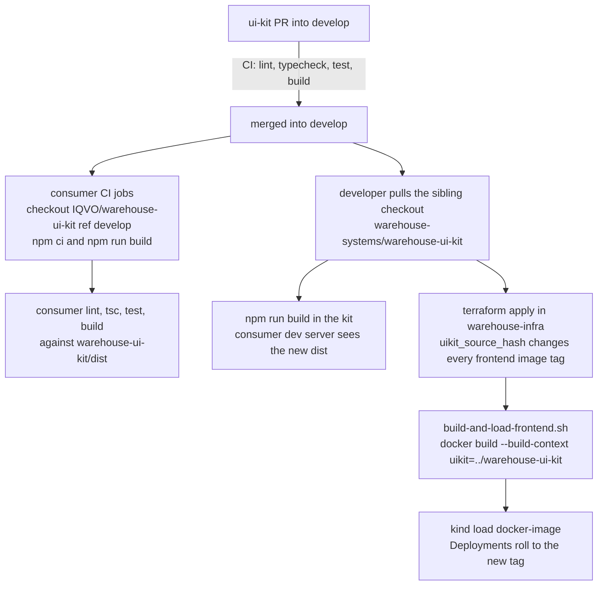

# Release and consumer pick-up

## Versioning: there is none yet

| Fact | Evidence |
|---|---|
| The package is never published | `package.json` has `"private": true`; no workflow runs `npm publish`; no registry is configured |
| The version is not bumped per change | `"version": "0.1.0"` (pre-1.0); consumers do not pin a version, they link a path |
| No git tags or GitHub releases | `git ls-remote --tags origin` returns nothing; `gh release list` is empty |
| No release workflow | `.github/workflows/` holds only `ci.yml`, `codeql.yml` and `ai-review.yml` |
| Branching | GitFlow: feature PRs into `develop`; `main` is updated by a `develop` → `main` merge (at the time of writing both point to the same commit) |

A "release" of the kit is therefore **merging into `develop`**: that is the ref every
consumer CI checks out, and the ref the local sibling checkout is normally on when images
are built.

## How a change reaches consumers

Source: `package.json`, `.github/workflows/ci.yml` of the consumers,
`warehouse-infra/terraform/frontends.tf` and `scripts/build-and-load-frontend.sh` (origin/develop).



### 1. Consumer CI

Every consumer with a web CI job checks out the kit beside itself at `ref: develop` and
builds it before its own steps (on `origin/develop`: `warehouse-console`,
`order-management`, `inventory-storage`, `wes-work-planning`, `fulfillment-execution`,
`workforce-management`, `facility-layout`, `process-path-management`,
`labor-performance`, `warehouse-planning`, `product-master`,
`network-inventory-planning`, `inbound-receiving`):

```yaml
- uses: actions/checkout@<sha>
  with:
    repository: IQVO/warehouse-ui-kit
    ref: develop
    path: warehouse-ui-kit
- run: npm ci && npm run build
  working-directory: warehouse-ui-kit
```

Consequences:

- A kit change is invisible to consumer CI until it is merged into `develop`. Merge the
  kit PR first, then the consumer PR that uses the new export.
- To test a consumer PR against an unmerged kit branch, point that consumer workflow's
  `ref:` at the kit branch temporarily and revert it before merging.
- A breaking change to an export's name or props breaks the **next** CI run of every
  consumer that uses it, even consumers nobody touched. Grep the consumers before merging:
  `grep -rn "@warehouse/ui-kit" ../*/web/src ../warehouse-console/src`.
- `network-fulfillment` declares the dependency in `web/package.json` but its `ci.yml` has
  no job that checks out the kit or builds `web/`, so its remote is not verified against
  kit changes in CI.

### 2. Local development

Consumers declare `"@warehouse/ui-kit": "file:../../warehouse-ui-kit"` (remotes, from
`<repo>/web`) or `"file:../warehouse-ui-kit"` (the console). npm installs a `file:`
directory dependency as a symlink, so after the first `npm install` in the consumer:

1. `git pull` (or switch branch) in `warehouse-systems/warehouse-ui-kit`.
2. `npm run build` there (or keep `npm run dev`, i.e. `vite build --watch`, running).
3. Restart or reload the consumer's dev server; it reads the rebuilt `dist/`.

There is nothing to bump, reinstall or publish. Never edit
`node_modules/@warehouse/ui-kit` in a consumer, and never commit `dist/`.

### 3. Images in the local kind cluster

`warehouse-infra/terraform/frontends.tf` computes `uikit_source_hash` from every file under
`warehouse-ui-kit/src` plus its `package.json`, and folds it into the content-addressed image
tag of the console and of every remote (`local-<hash>`). Any kit change therefore changes
every frontend's tag on the next `terraform apply`, which rebuilds the images with
`scripts/build-and-load-frontend.sh` and rolls the Deployments. The script passes the
**local sibling checkout** as the `uikit` named build context, so whatever branch that
checkout is on is what ships to the cluster.

Inside each consumer image (`web/Dockerfile`, or the console's root `Dockerfile`, all on
`node:22-bookworm-slim`), a `uikit-build` stage copies the context, runs
`rm -rf node_modules package-lock.json && npm install --no-save && npm run build`, and only
`package.json` and `dist` are copied into `/workspace/warehouse-ui-kit` for the consumer's
build stage. The kit's committed lockfile is not used there (Linux native bindings for
Vite 8 are missing from a macOS-authored lockfile). The one exception on `origin/develop`
is `facility-layout/web/Dockerfile`, which keeps the lockfile and runs
`rm -rf node_modules && npm ci && npm run build`; if that image fails with
`Cannot find native binding`, see [Troubleshooting](troubleshooting.md).

### 4. At runtime

The console and every remote declare `"@warehouse/ui-kit": { singleton: true }` in their
Module Federation `shared` map. Each bundle carries a copy of the kit compiled from the
checkout it was built from, and the federation runtime serves one of them to all
participants. If the console and a remote were built from different kit commits, only one
copy wins at runtime, so mixed builds can render a remote with a kit version it was not
built against. Rebuild all frontends together after a kit change (the shared
`uikit_source_hash` in the image tags does exactly that).

## Checklist for shipping a kit change

1. In this repo: change, add or update `*.test.tsx`, export new public API from
   `src/index.ts`, `make check-all`.
2. PR into `develop`; CI must be green (`lint`, `typecheck`, `guide-lint`, `test`, `build`,
   `dependency-audit`, `trivy-scan`, CodeQL).
3. If the change renames or removes an export or a prop, open the consumer PRs that adapt
   to it and merge them right after the kit PR.
4. After merge: `npm run build` in the local checkout, verify in at least one consumer
   (its `npm run typecheck`, `npm test`, `npm run build`), and redeploy frontends through
   `warehouse-infra` (`terraform apply`) so every image picks up the new hash.
5. Update [Components](../components.md) or [Tokens](../tokens.md) for any new prop,
   component, status or token.
