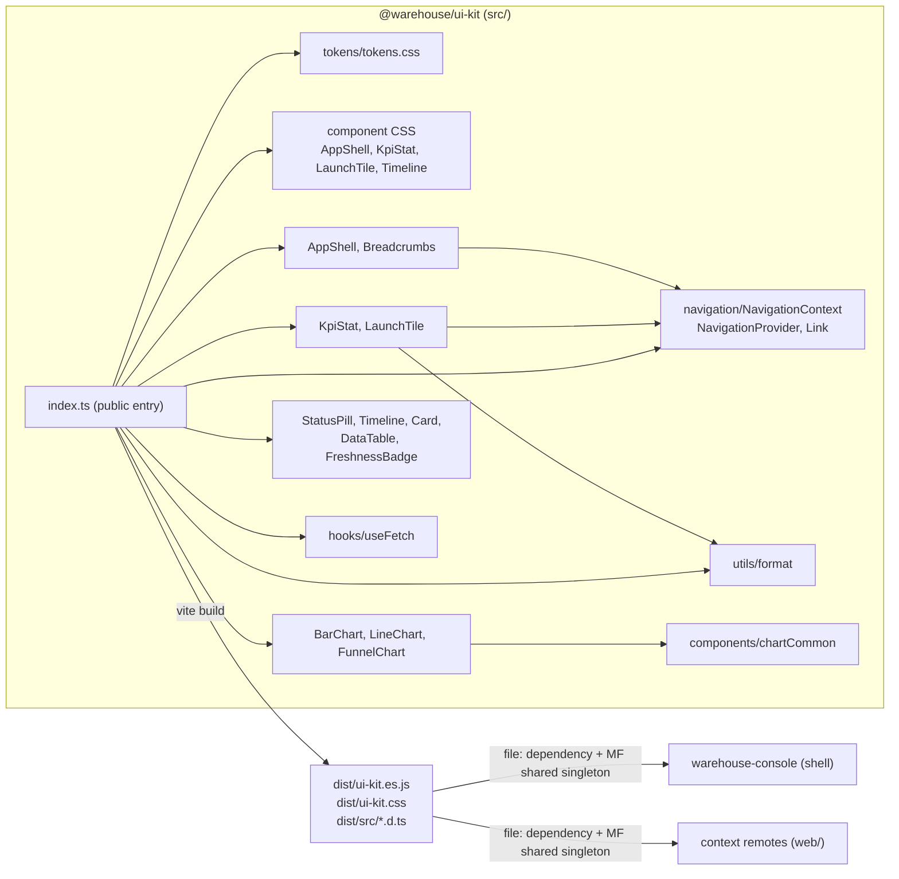

# Architecture

`@warehouse/ui-kit` is a Vite **library build** (not an app) of React components, CSS
design tokens, one hook, a navigation-injection context and a set of formatters. It has
no domain layer, no adapters and no runtime process; the hexagonal layout used by the
backend contexts does not apply here.

## Source layout

| Path | Contents | Public exports (from `src/index.ts`) |
|---|---|---|
| `src/tokens/tokens.css` | Every `--wh-*` CSS custom property, base element styles, `.wh-numeric`, `.wh-visually-hidden`, the `wh-shimmer` keyframes, reduced-motion overrides and the `[data-surface="monitor"]` calibration | Shipped as `@warehouse/ui-kit/tokens.css` (see [Tokens](../tokens.md)) |
| `src/components/StatusPill.tsx` | Domain-status pill and the `STATUS_TONE` table | `StatusPill`, `DomainStatus`, `StatusPillProps` |
| `src/components/Timeline.tsx` + `Timeline.css` | Lifecycle stepper | `Timeline`, `TimelineStep`, `TimelineStepState` |
| `src/components/Card.tsx` | Bordered panel | `Card` |
| `src/components/DataTable.tsx` | Typed, column-driven table | `DataTable`, `Column`, `DataTableProps` |
| `src/components/FreshnessBadge.tsx` | Projection-lag badge | `FreshnessBadge` |
| `src/components/KpiStat.tsx` + `KpiStat.css` | Control-tower stat panel | `KpiStat`, `KpiStatProps`, `KpiTone`, `KpiState`, `KpiFormat`, `KpiThreshold` |
| `src/components/LaunchTile.tsx` + `LaunchTile.css` | Launchpad tile | `LaunchTile`, `LaunchTileProps` |
| `src/components/AppShell.tsx` + `AppShell.css` | Top chrome and breadcrumbs | `AppShell`, `Breadcrumbs`, `NavItem` |
| `src/components/BarChart.tsx`, `LineChart.tsx`, `FunnelChart.tsx` | Dependency-free SVG charts | `BarChart`, `BarChartProps`, `LineChart`, `LineChartProps`, `LineChartThreshold`, `FunnelChart`, `FunnelChartProps` |
| `src/components/chartCommon.ts` | Chart helpers (`CHART_TONE_COLOR`, `formatChartValue`, `safeValue`, `ratioOfMax`, `maxOf`, `truncateLabel`) | Only the types `ChartDatum`, `ChartTone`; the helpers are internal |
| `src/navigation/NavigationContext.tsx` | Router-agnostic link injection and the internal `Link` primitive | `NavigationProvider`, `useLinkComponent`, `LinkComponent`, `LinkProps` (`Link` itself is internal) |
| `src/hooks/useFetch.ts` | Typed fetch hook with polling | `useFetch`, `FetchError`, `FetchState`, `UseFetchOptions` |
| `src/utils/format.ts` | Shared formatters | `NO_VALUE`, `formatNumber`, `formatCompact`, `formatPercent`, `formatDuration`, `formatInstant`, `secondsSince` |
| `src/test/setup.ts` | Vitest setup (jest-dom matchers, RTL `cleanup()` after each test) | none |
| `src/index.ts` | The single public entry point and the stylesheet import order | everything above |

Anything not exported from `src/index.ts` does not exist for consumers: they import from
`@warehouse/ui-kit`, never from `src/`. `TimelineOrientation` is declared and used by
`Timeline` but is not re-exported, so consumers type the prop as the string union.

## Component and dependency diagram

Source: `src/index.ts`, `src/components/*.tsx`, `src/navigation/NavigationContext.tsx`, `vite.config.ts`.



Internal dependencies are deliberately shallow: `AppShell`, `Breadcrumbs`, `KpiStat` and
`LaunchTile` render links through the internal `Link` (`NavigationContext.tsx`), `KpiStat`
formats through `utils/format`, and the three charts share `chartCommon.ts`. `StatusPill`,
`Timeline`, `Card`, `DataTable` and `FreshnessBadge` depend only on React and the tokens.

## Styling model

- Every color, space, radius, font and motion value is a `--wh-*` custom property from
  `tokens.css`; components reference them with `var()` and never hard-code hex values.
- `StatusPill`, `Card`, `DataTable`, `FreshnessBadge` and the charts style themselves with
  inline `style` objects. `AppShell`, `Breadcrumbs`, `KpiStat`, `LaunchTile` and `Timeline`
  use BEM-style classes (`wh-shell__*`, `wh-breadcrumbs__*`, `wh-kpi__*`,
  `wh-launch-tile__*`, `wh-timeline__*`) from their own stylesheet because inline styles
  cannot express `:hover`, `:focus-visible` or media queries.
- Component stylesheets are imported in `src/index.ts`, not beside the component:
  `tsconfig.app.json` sets `allowArbitraryExtensions`, under which a relative
  `import "./Foo.css"` resolves to a `Foo.d.css.ts` declaration. The import order there
  is the cascade order: `tokens.css` first, then `AppShell.css`, `KpiStat.css`,
  `LaunchTile.css`, `Timeline.css`.
- The charts set SVG `fill`/`stroke` through `style`, because CSS custom properties are
  ignored inside SVG presentation attributes (`fill="var(--x)"`).

## Build output

`npm run build` runs `tsc -b && vite build` with `vite.config.ts`:

| Setting | Value | Effect |
|---|---|---|
| `build.lib.entry` | `src/index.ts` | One entry point |
| `build.lib.formats` / `fileName` | `["es"]`, `ui-kit.${format}.js` | `dist/ui-kit.es.js` (ESM only, no CJS/UMD) |
| `build.rollupOptions.external` | `react`, `react-dom`, `react/jsx-runtime` | React is never bundled; the host supplies one copy |
| `build.cssCodeSplit` | `false` | All CSS (tokens + component sheets) folds into one `dist/ui-kit.css` |
| `vite-plugin-dts` | `tsconfigPath: tsconfig.app.json`, `insertTypesEntry: true` | Declarations under `dist/src/` (entry `dist/src/index.d.ts`); test files are excluded from that project so they never enter the public types |

`dist/` is gitignored, so a fresh checkout has no JS or types until the build runs.

## How consumers import it

`package.json` maps the build output:

| Field | Value |
|---|---|
| `main`, `module` | `./dist/ui-kit.es.js` |
| `types` | `./dist/src/index.d.ts` |
| `exports["."]` | `types: ./dist/src/index.d.ts`, `import: ./dist/ui-kit.es.js` |
| `exports["./tokens.css"]` | `./dist/ui-kit.css` |
| `files` | `["dist"]` |
| `peerDependencies` | `react ^19.0.0`, `react-dom ^19.0.0` |

A consumer therefore writes:

```tsx
import "@warehouse/ui-kit/tokens.css"; // tokens + every component stylesheet
import { AppShell, KpiStat, StatusPill, useFetch } from "@warehouse/ui-kit";
```

On `origin/develop` of the consuming repos, `warehouse-console` declares
`"@warehouse/ui-kit": "file:../warehouse-ui-kit"` and each context remote's `web/package.json`
declares `"file:../../warehouse-ui-kit"`. Both the console's and the remotes'
`vite.config.ts` list `"@warehouse/ui-kit": { singleton: true }` in the Module Federation
`shared` map (beside `react`, `react-dom` and `react-router-dom`), so one copy of the kit
serves the shell and every remote at runtime. See [Release](../operations/release.md) for
the full pick-up path and [Quickstart](quickstart.md) for local linking.

## Design decisions visible in the code

- **No router import.** `NavigationContext.tsx` lets the host inject its router's link
  component; with no provider the default is a plain `<a href>`, so remotes run standalone
  unchanged. Importing `react-router-dom` here would pin the router version for the whole
  fleet.
- **No charting library.** The kit is a shared singleton; chart weight would be paid on
  every screen. Charts are plain SVG sized for dashboard cards (no zoom, legend or
  crosshair; the native `<title>` is the tooltip).
- **No data-fetching library.** `useFetch` is a minimal hook rather than react-query, to
  avoid a shared query-cache singleton across federated remotes.
- **Missing data is not zero.** `NO_VALUE` (an em dash) is rendered for null or
  non-finite values; `KpiStat` and `Timeline` have explicit "unavailable" states that read
  louder than a healthy value.
